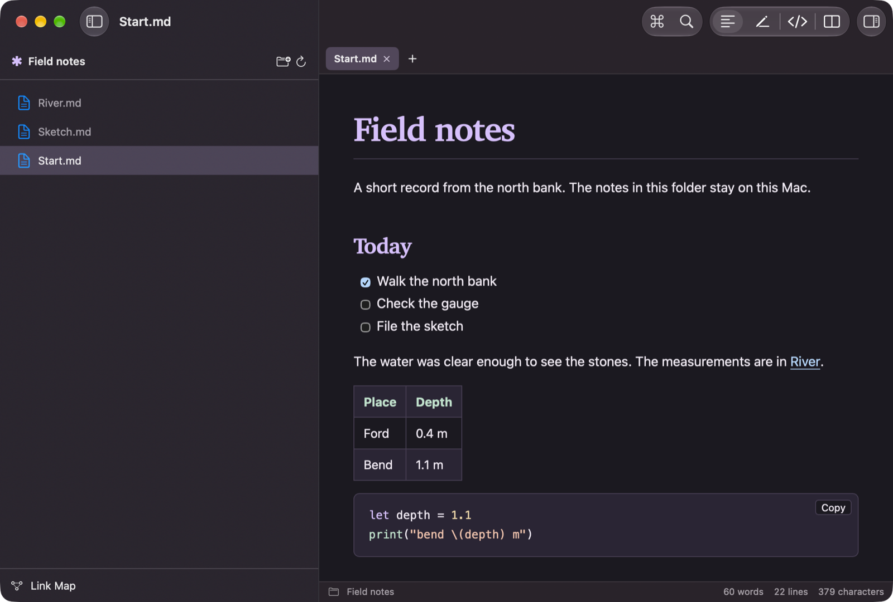
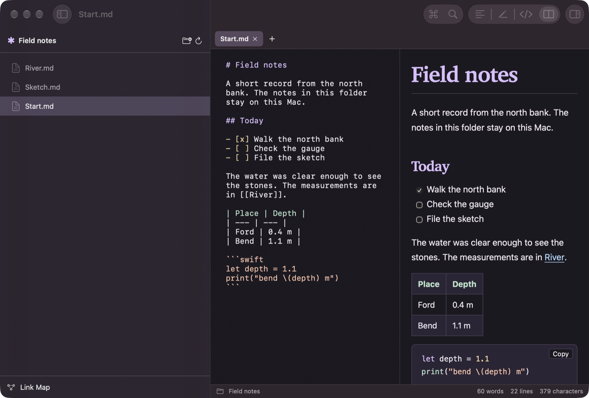

# Aster

Aster is a native macOS editor and reader for Markdown. Open a single file or work through a folder of notes. Finder can show a rendered preview when you press Space, even while Aster is closed.





## What you can do

- Read, write, edit source, or see the source and preview side by side with synchronized scrolling.
- Render tables, task lists, syntax-highlighted code, Mermaid diagrams, math, and YAML front matter offline.
- Browse a folder in tabs, jump to headings, search sections or matching lines, and inspect backlinks and broken document links.
- Open another note in the workspace with a wikilink such as `[[Note]]`. Copy a code block from the preview.
- See the word count for the open note. Each note keeps the view mode you last used for it.
- Edit with native find and replace, formatting shortcuts, focus mode, and typewriter mode.
- Print a preview or export it as HTML or PDF.

Aster works with plain Markdown files on disk. It displays local images from the document folder or the open workspace. It leaves remote images unloaded. The first time Aster opens, it asks whether Finder should open Markdown files in Aster. Choose **Not Now** to keep your current app. You can choose Aster later in **Aster → Settings**.

## Install

Aster targets macOS 14 and later on Apple silicon and Intel. Download the DMG from [Releases](https://github.com/Kasakir-AI/Aster/releases), open it, and drag Aster to Applications. A ZIP is also available. Launch Aster once to register its extensions.

You can also install Aster with Homebrew.

```sh
brew install --cask kasakir-ai/tap/aster
```

If Homebrew reports that the cask is untrusted, run `brew trust --cask kasakir-ai/tap/aster` once, then retry the install.

Run `brew update` and `brew upgrade --cask kasakir-ai/tap/aster` to update.

The release downloads are signed with Developer ID and notarized by Apple.

Aster is also coming to the Mac App Store. Keep one edition installed. Both editions use the same app ID and settings, so a switch keeps your preferences, recent files, and folder permissions. To switch from Homebrew, run `brew uninstall --cask aster` before you install from the App Store.

### Finder Quick Look

In Finder, select a Markdown file and press Space. If Finder shows raw text, look for **Aster Markdown Preview** under **System Settings → General → Login Items & Extensions → Quick Look**. Check for another enabled Markdown preview provider if Finder still shows a different preview.

Finder Quick Look renders math and images stored in the same folder as the note. Mermaid blocks stay as source. Open the file in Aster to see the diagram.

### Xcode

Enable **Aster for Xcode** under **System Settings → General → Login Items & Extensions → Xcode Source Editor**, then restart Xcode. Open a Markdown file and choose **Editor → Aster for Xcode → Preview Buffer in Aster**. The command opens the current text in one preview, including unsaved edits. Aster reuses that preview. The view mode saved for the next launch stays as it was.

## Appearance

Aster and Finder Quick Look start in a dark pastel palette. In **Aster → Settings**, choose **Light** or **Follow macOS** to change the app appearance. Finder previews remain dark.

The editor follows CommonMark syntax and supports GitHub Flavored Markdown features such as tables and task lists. Syntax colors target a 4.5:1 contrast ratio against the editing and reading backgrounds. [GitHub Flavored Markdown specification](https://github.github.com/gfm/) · [WCAG contrast minimum](https://www.w3.org/WAI/WCAG22/Understanding/contrast-minimum.html)

## Keyboard shortcuts

| Shortcut | Action |
| --- | --- |
| ⌘O | Open Markdown |
| ⇧⌘O | Open a workspace |
| ⌘T | Open Quickly |
| ⇧⌘R | Cycle Read, Write, Source, and Split |
| ⌘F | Find in the current document |
| ⌥⌘F | Find and replace in the editor |
| ⇧⌘F | Search the workspace |
| ⇧⌘G | Open the Link Map |
| ⇧⌘E | Export PDF from a preview |

## Build

Install Xcode 16 or later and Node.js 22 or later. From the repository root, run the build.

```sh
./build.sh
open .build/Xcode/Build/Products/Release/Aster.app
```

The build installs the locked renderer dependencies, runs the tests, and creates a universal app bundle. Run `./test.sh` to repeat the tests after installing those dependencies. Run `./scripts/package.sh .build/dist` after a successful build to create and verify the DMG, ZIP, and checksum file.

## Privacy

Aster has no account, analytics, or tracking. It reads and saves Markdown files you choose and keeps your notes on your Mac. You control how long to keep those files.

Aster stores preferences, recent file locations, and permission bookmarks on your Mac. In Settings, you can turn off reopening files and workspaces. Choose **File → Open Recent → Clear Menu** to clear the recent file menu. Removing Aster’s local app data clears its saved preferences and permission bookmarks.

Web links open in your browser. Report a Bug and Request a Feature open GitHub with the Aster version filled in. You choose what else to share. In the direct download, Check for Updates asks GitHub whether a newer release exists. Aster does not send notes or usage data.

## Support Aster

Aster is free to download here. To support its development, you can [buy Aster on the Mac App Store](https://apps.apple.com/app/id6838112678). It's the same app, with updates through the App Store. You can also [sponsor on GitHub](https://github.com/sponsors/Kasakir-AI), once or monthly, or star this repository so more people find it.

### Sponsors

<!-- sponsors:start -->
<!-- This section is updated automatically. Edits here are overwritten. -->

No sponsors featured here yet. [Become the first](https://github.com/sponsors/Kasakir-AI)!
All sponsors: [SPONSORS.md](https://github.com/Kasakir-AI/.github/blob/main/SPONSORS.md).
<!-- sponsors:end -->

## Contributing

Report a bug or send a change on [GitHub](https://github.com/Kasakir-AI/Aster/issues). Include the Aster version and the macOS version with a bug report. Planned work is listed in the [roadmap](ROADMAP.md).

Aster is available under the [MIT license](LICENSE). The app bundle includes notices for third-party packages.
